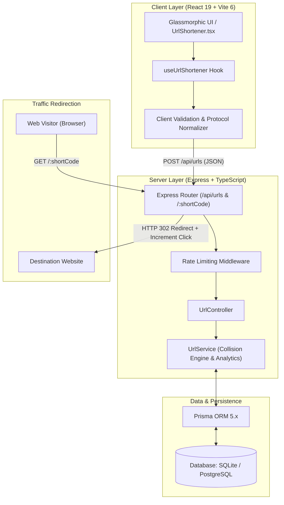

<div align="center">

# ⚡ Shortly

**The Modern, High-Performance URL Shortening & Brand Redirection Platform**

[](https://github.com/Tejas0113/Shortly/stargazers)
[](LICENSE)
[](https://react.dev)
[](https://www.typescriptlang.org)
[](https://expressjs.com)
[](https://www.prisma.io)
[](https://tailwindcss.com)
[](https://vitest.dev)

<br />

<p align="center">
  <a href="#-key-features"><b>Key Features</b></a> •
  <a href="#-system-architecture"><b>Architecture</b></a> •
  <a href="#-quick-start"><b>Quick Start</b></a> •
  <a href="#-api-documentation"><b>API Reference</b></a> •
  <a href="#-custom-domain-system"><b>Domains</b></a> •
  <a href="#-deployment"><b>Deployment</b></a> •
  <a href="#-author"><b>Author</b></a>
</p>

---

</div>

## 🌟 Overview

**Shortly** is an enterprise-grade, full-stack URL shortener designed to transform long, messy web addresses into clean, memorable, and trackable links in milliseconds. Engineered from the ground up without relying on slow third-party shortening APIs, Shortly gives you total ownership over your data, your custom domain branding, and your click metrics.

Featuring sub-50ms atomic HTTP 302 redirects, collision-resistant random code generation, personalized custom aliases, and a modern dark/light glassmorphic UI, Shortly offers the polish of tools like Bitly or Dub.co in a completely open-source, self-hostable package.

---

## ✨ Key Features

- **🚀 Sub-50ms Atomic Redirections**: Direct HTTP 302 redirects with low latency and zero unnecessary intermediate landing hops.
- **🏷️ Custom Branded Aliases**: Create human-readable, custom links (e.g. `shortly.localhost/coke01`, `shortly.link/portfolio`, or `mybrand.com/launch`) with automated collision validation.
- **🎲 Collision-Proof Auto Generation**: Cryptographically secure 6-character alphanumeric code engine capable of generating over **68.7 billion** unique short links.
- **📊 Atomic Real-Time Click Tracking**: Every redirect atomically increments click analytics in the database with concurrency safety.
- **🌐 Dynamic Multi-Domain Architecture**: 
  - Works out-of-the-box locally via RFC 6761 (`shortly.localhost:3000`) without DNS errors.
  - Seamlessly adapts to custom production domains (e.g. `short.ly` or `yourdomain.com`).
- **🛡️ Defensive Security & Rate Limiting**: Built-in sliding-window rate limiters, input normalization (auto-prepends `https://`), XSS sanitization, and reserved keyword protection.
- **🎨 State-of-the-Art Glassmorphic UI**: High-contrast, dark-mode-first aesthetic crafted with Tailwind CSS v4, smooth animations, and zero dependency on bloated component libraries.
- **📋 Local History & Clipboard Integration**: Instant 1-click clipboard copy, native Web Share API support, and local activity history.
- **🧪 100% Tested Backend**: Comprehensive automated test suite using **Vitest** and **Supertest** covering API creation, collision handling, and URL normalization.

---

## 📐 System Architecture



---

## 🛠️ Tech Stack

| Layer | Technologies |
| :--- | :--- |
| **Frontend Framework** | **React 19**, TypeScript, Vite 6 |
| **Styling & Design** | **Tailwind CSS v4**, Lucide React, Glassmorphic CSS Tokens |
| **Backend Runtime** | **Node.js** (v20+ recommended), **Express.js**, TypeScript |
| **ORM & Database** | **Prisma ORM 5.x**, SQLite (Default) / PostgreSQL (Production Ready) |
| **Testing** | **Vitest 4**, Supertest |
| **Bundling & Build** | **esbuild**, Vite Build Pipeline |

---

## ⚡ Quick Start

### 1. Prerequisites
- **Node.js** (v18.x or later)
- **npm** or **bun** / **pnpm**

### 2. Clone the Repository
```bash
git clone https://github.com/Tejas0113/Shortly.git
cd Shortly
```

### 3. Install Dependencies
```bash
npm install
```

### 4. Setup Database
Initialize your SQLite database and generate the Prisma Client:
```bash
npx prisma db push
```

### 5. Launch the Development Server
```bash
npm run dev
```

Shortly will be running locally at:
- **`http://localhost:3000`**
- **`http://shortly.localhost:3000`** *(Works in all Chromium/WebKit browsers out-of-the-box via RFC 6761)*

---

## 📡 API Documentation

Shortly provides a clean RESTful JSON API for programmatic URL shortening and analytics.

### 1. Create a Short URL
Generates a new shortened link or associates a custom alias.

- **Method**: `POST`
- **Endpoint**: `/api/urls`
- **Headers**: `Content-Type: application/json`

#### Request Body
```json
{
  "originalUrl": "https://coca-cola-scroll-website.vercel.app/#experience",
  "customAlias": "coke01"
}
```

#### Response (`201 Created`)
```json
{
  "success": true,
  "shortCode": "coke01",
  "shortUrl": "http://shortly.localhost:3000/coke01",
  "originalUrl": "https://coca-cola-scroll-website.vercel.app/#experience",
  "createdAt": "2026-10-27T04:54:22.295Z",
  "clickCount": 0,
  "customAlias": true
}
```

---

### 2. Fetch URL Details & Analytics
Retrieves metadata and live click counts for an existing short code.

- **Method**: `GET`
- **Endpoint**: `/api/urls/:shortCode`

#### Response (`200 OK`)
```json
{
  "success": true,
  "data": {
    "shortCode": "coke01",
    "shortUrl": "http://shortly.localhost:3000/coke01",
    "originalUrl": "https://coca-cola-scroll-website.vercel.app/#experience",
    "createdAt": "2026-10-27T04:54:22.295Z",
    "clickCount": 42,
    "customAlias": true
  }
}
```

---

### 3. Redirection Endpoint
Instantly forwards the visitor to the destination URL and atomically increments click metrics.

- **Method**: `GET`
- **Endpoint**: `/:shortCode`
- **Response**: `HTTP 302 Found` with `Location: <destination_url>` header.

---

## 🏷️ Custom Domain System

Shortly supports both live browser testing and production branded domains:

| Preset | Target Environment | Resolves In Browser | Description |
| :--- | :--- | :---: | :--- |
| **`shortly.localhost:3000`** | Local Development | ✅ Yes | Uses RFC 6761 loopback to keep "shortly" in the domain without DNS setup. |
| **`localhost:3000`** | Local Development | ✅ Yes | Standard direct localhost testing. |
| **`short.ly`** | Production | 🌐 DNS Required | Branded short domain preview (requires domain purchase & DNS configuration). |
| **`shortly.link`** | Production | 🌐 DNS Required | Alternative branded extension. |

---

## 🧪 Testing & Quality Assurance

Shortly is tested with end-to-end integration tests covering URL validation, rate limits, collision handling, and redirection:

```bash
# Run backend test suite
npm test

# Type-check TypeScript across frontend and backend
npm run lint

# Build production bundle
npm run build
```

```
✓ server/src/__tests__/url.test.ts (12 tests)
  ✓ 1. Health check endpoint returns status: ok
  ✓ 2. Automatic short code creation works with valid URL
  ✓ 3. Reject invalid or malformed URLs with 400
  ✓ 4. Custom alias creation works as expected
  ✓ 5. Duplicate custom alias detection returns 409 Conflict
  ✓ 6. Rejects reserved aliases and invalid character custom aliases
  ✓ 7. URL details lookup GET /api/urls/:shortCode works
  ✓ 8. Short link redirect GET /:shortCode performs HTTP 302 and increments clickCount
  ✓ 9. Non-existent short link redirect returns 404 for JSON client
  ✓ 10. Auto-normalizes URLs without protocol (e.g. google.com)
  ✓ 11. Idempotently returns existing short link when same custom alias is submitted
  ✓ 12. Resolves and redirects even if user visits duplicated path (/coke/coke)
```

---

## 🚀 Deployment Guide

### Deploying to Render / Railway (Recommended for SQLite)
Since Shortly uses a local SQLite database by default, platforms that support persistent Node.js servers run it seamlessly with zero configuration changes:

1. Push your code to your GitHub repository.
2. Log into [Render.com](https://render.com) or [Railway.app](https://railway.app).
3. Connect your repository and select **Web Service**.
4. Set build & start settings:
   - **Build Command**: `npm install && npm run build`
   - **Start Command**: `npm start`
5. Click **Deploy**. Your custom shortened URLs will now work worldwide!

### Deploying to Vercel (Serverless)
To deploy on Vercel, attach a free cloud PostgreSQL or Serverless SQLite database (e.g. [Neon](https://neon.tech), [Supabase](https://supabase.com), or [Turso](https://turso.tech)):
1. Switch `provider = "postgresql"` in `prisma/schema.prisma`.
2. Add your `DATABASE_URL` in Vercel project environment variables.
3. Set the build command to: `prisma generate && prisma db push && vite build`.

---

## 🛡️ Security Features

- **Reserved Keyword Blacklist**: Protects internal routes (`/api`, `/health`, `/admin`, `/login`, `/assets`, `/favicon.ico`) from being claimed as aliases.
- **Sanitized Inputs**: Strict Regex validation (`^[a-zA-Z0-9_-]{3,20}$`) prevents path traversal and script injection.
- **Sliding-Window Rate Limiting**: Mitigates automated denial-of-service and brute-force alias generation.
- **Safe 302 Header Construction**: Validates target URLs to guard against open-redirect vulnerabilities.

---

## 🤝 Contributing

Contributions, issues, and feature requests are welcome!

1. Fork the Project (`https://github.com/Tejas0113/Shortly/fork`)
2. Create your Feature Branch (`git checkout -b feature/AmazingFeature`)
3. Commit your Changes (`git commit -m 'Add some AmazingFeature'`)
4. Push to the Branch (`git push origin feature/AmazingFeature`)
5. Open a Pull Request

---

## 📄 License

Distributed under the **MIT License**. See [`LICENSE`](LICENSE) for more information.

---

## 👤 Author

**Tejas Namde**
- GitHub: [@Tejas0113](https://github.com/Tejas0113)
- Project Repository: [https://github.com/Tejas0113/Shortly](https://github.com/Tejas0113/Shortly)

<div align="center">
  <sub>Built with ❤️ using React 19, TypeScript, Express, and Tailwind CSS.</sub>
</div>
